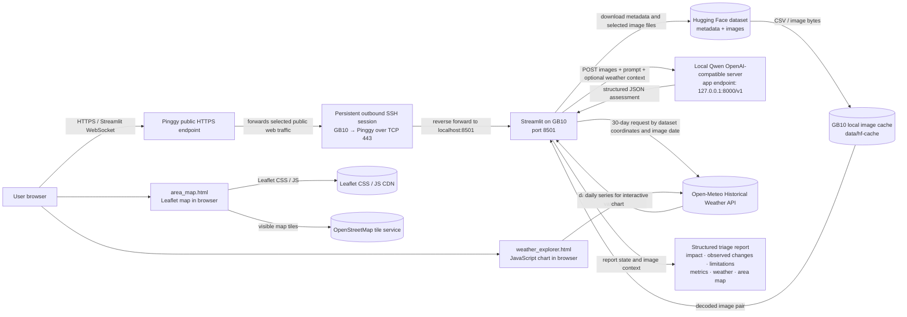

# Saving Texas Architecture

## System overview

Saving Texas is a Streamlit application running on GB10. It selects a linked before/response image pair from the UTSA Flood Images dataset, asks a locally hosted Qwen vision model to compare the images, and renders a triage report. If pair coordinates and an acquisition date are available, the app retrieves a 30-day historical weather window and supplies it as context. The report also includes a JavaScript weather chart and a coordinate-based map.



The diagram shows logical traffic paths. The Qwen and Streamlit processes run on the same GB10 in the current setup; the Hugging Face, Open-Meteo, Pinggy, and OpenStreetMap services are external dependencies.

## Request and analysis sequence

```mermaid
sequenceDiagram
    actor Visitor
    participant Browser
    participant Pinggy as Pinggy HTTPS edge
    participant SSH as GB10 SSH client
    participant Streamlit as Streamlit app :8501
    participant HF as Hugging Face dataset
    participant Weather as Open-Meteo API
    participant Qwen as Local Qwen API :8000
    participant CDN as Leaflet CDN
    participant OSM as OpenStreetMap tiles

    Visitor->>Browser: Open current public app URL
    Browser->>Pinggy: HTTPS request / Streamlit WebSocket
    Pinggy->>SSH: Route request through existing reverse SSH tunnel
    SSH->>Streamlit: Forward to localhost:8501
    Visitor->>Browser: Select city and image pair
    Browser->>Pinggy: Send UI event over existing HTTPS/WebSocket connection
    Pinggy->>SSH: Forward event through existing reverse tunnel
    SSH->>Streamlit: Deliver event to port 8501
    Streamlit->>HF: Fetch metadata; fetch selected images if uncached
    HF-->>Streamlit: CSV metadata and image files
    Visitor->>Browser: Click Analyze changes
    Browser->>Pinggy: Send analysis action over WebSocket
    Pinggy->>SSH: Forward action through existing reverse tunnel
    SSH->>Streamlit: Deliver action to port 8501
    Streamlit->>Weather: Request daily temperature and rain for the image-date window
    Weather-->>Streamlit: Weather context, or unavailable
    Streamlit->>Qwen: Send before/response images, analysis prompt, optional weather
    Qwen-->>Streamlit: JSON findings, impact ranges, confidence and limitations
    Streamlit-->>SSH: Return rendered report
    SSH-->>Pinggy: Return over reverse tunnel
    Pinggy-->>Browser: Deliver report over HTTPS
    Browser->>Weather: Fetch chart series from weather iframe
    Browser->>Pinggy: Request map iframe document
    Browser->>CDN: Load Leaflet CSS and JavaScript
    Browser->>OSM: Fetch tiles for the visible map area
```

The in-browser weather chart makes its own request to Open-Meteo. Separately, the Streamlit server requests the same date window so Qwen can receive weather as optional context. The server response is cached for six hours; the chart request is made from the browser.

## Repository modules and responsibilities

| Module | Responsibility |
| --- | --- |
| [`app.py`](app.py) | Streamlit entry point and orchestration. Renders image-pair and model settings, calls dataset/weather/model services, stores the assessment in Streamlit session state, and displays the report tabs. Caches the repository, image-pair list, images, weather context, and Qwen client. |
| [`flood_app/dataset.py`](flood_app/dataset.py) | `DatasetRepository` downloads `image_metadata.csv` and selected images from `jennifer-fowler/UTSA-flood-images`. It pairs `before` and `response` records using `paired_image_id`, validates local cache paths, and exposes image conversion and locality filtering helpers. |
| [`flood_app/analyzer.py`](flood_app/analyzer.py) | `LocalQwenAnalyzer` encodes both images as JPEG data URLs, builds the evidence-focused prompt, calls the OpenAI-compatible `/chat/completions` endpoint, and parses the response JSON. Optional weather values are explicitly limited to contextual use. |
| [`flood_app/models.py`](flood_app/models.py) | Defines `ImageRecord`, `ImagePair`, and `DamageAssessment`. Converts incomplete model JSON into stable application objects with safe defaults. |
| [`flood_app/weather.py`](flood_app/weather.py) | `HistoricalWeatherProvider` requests daily `temperature_2m_mean` and `rain_sum` from Open-Meteo for 30 days centered on the chosen image date, then calculates the window’s mean temperature, cumulative rainfall, rainy-day count, and maximum daily rainfall. Invalid or missing coordinates/dates skip the request. |
| [`flood_app/weather_explorer.html`](flood_app/weather_explorer.html) | Browser-side JavaScript weather application. Fetches historical daily values and draws a time series and histogram with measure/window controls. |
| [`flood_app/area_map.html`](flood_app/area_map.html) | Browser-side Leaflet map. Loads Leaflet CSS/JS from unpkg, centers a marker on the selected dataset coordinate, and displays OpenStreetMap attribution. |
| [`tests/test_services.py`](tests/test_services.py) | Unit tests for dataset pairing, analyzer prompt/JSON behavior, impact metric preservation, and weather response summaries. |
| [`requirements.txt`](requirements.txt) | Python runtime dependencies: Streamlit, Requests, and Pillow. The chart and map use browser-loaded JavaScript libraries. |

## Runtime data and service integration

### UTSA image pair

1. `available_pairs()` asks `DatasetRepository` to download/read `image_metadata.csv` from the Hugging Face dataset repository.
2. The repository matches a row marked `before` to its `response` record through `paired_image_id` and the image-role field.
3. The app filters pair metadata by the selected locality. It downloads the two selected image assets only when they are not in `data/hf-cache`.
4. The images are decoded with Pillow and shown side by side. Coordinates are taken from the response image record, falling back to the before record when necessary.

### Qwen image analysis

Clicking **Analyze changes** invokes `qwen_analyzer(...).analyze(...)` in `app.py`. The default endpoint is `http://127.0.0.1:8000/v1`; `QWEN_BASE_URL` and `QWEN_MODEL` override the endpoint and model. The app sends the two selected images and a prompt to `/chat/completions`. The response contains impact fields, observed-change evidence, approximate visual metrics, confidence, and limitations. The app parses that JSON into `DamageAssessment` and renders it in the report. The Qwen server is a separate local process; it is not included in this repository and the app does not download the model.

### Temperature and rainfall

When a valid pair coordinate and image date are present, `HistoricalWeatherProvider` sends the selected coordinates and a 30-day date range to `https://archive-api.open-meteo.com/v1/archive`. The request asks for `temperature_2m_mean` and `rain_sum` with the coordinate-resolved timezone. The result is supplied to Qwen as daily context. Qwen is instructed not to use weather to calculate visible-scene/road percentages or raise confidence without visual evidence. If the request fails or coordinates/date are missing, Qwen analyzes the images alone.

The Metrics tab embeds the JavaScript weather chart. That browser component independently fetches the same API data so users can select temperature or rainfall and inspect the daily distribution. Open-Meteo’s default Best Match product is gridded historical/reanalysis data, not a local weather-station reading.

### Area map

The Area map tab embeds `area_map.html`. Leaflet draws the selected dataset coordinate over OpenStreetMap tiles. The tile service receives map tile requests from the user’s browser; the app does not geocode addresses or send requests to Google Maps.

## Public access and the reverse SSH tunnel

The current publishing path uses [Pinggy’s SSH remote port forwarding](https://pinggy.io/docs/usages/). It is **not a VPN**: it does not join the visitor’s computer to GB10’s private network or route arbitrary IP traffic. It publishes a web endpoint that forwards only to the local web service selected in the SSH command.

The current command is equivalent to:

```bash
ssh -p 443 \
  -o BatchMode=yes \
  -o StrictHostKeyChecking=accept-new \
  -o ConnectTimeout=10 \
  -R 0:localhost:8501 \
  a.pinggy.io
```

- `ssh` runs on GB10 and opens an **outbound** connection to Pinggy on TCP port 443. This can work behind NAT or a firewall that permits outbound SSH over port 443.
- `-R 0:localhost:8501` asks Pinggy to allocate a public forwarding endpoint (`0` means an allocated remote port/endpoint) and map incoming tunnel traffic back to `localhost:8501` on GB10.
- The browser connects to the public Pinggy HTTPS URL. Pinggy routes the web request over the already-open SSH reverse tunnel to Streamlit. The browser-to-Pinggy hop uses HTTPS; the established GB10-to-Pinggy tunnel uses SSH encryption. The app then replies over that path.
- Only port `8501` is selected by this Pinggy tunnel. The Qwen API on port `8000` is not part of the reverse-forward command.
- The public URL is a shareable, open app URL; the app currently has no login gate. On the [free Pinggy plan](https://pinggy.io/), the session is time-limited and a restart can issue a different URL.

This distinction matters on GB10: at the time this document was written, Streamlit listens on `0.0.0.0:8501` and the Qwen process listens on `0.0.0.0:8000`. That means both bind to all host interfaces; the Pinggy command itself forwards only 8501, but host firewall/network rules separately determine whether either port is reachable directly. For a tunnel-only deployment, bind Streamlit to loopback or restrict port 8501 at the host/network firewall, and bind/restrict the Qwen endpoint to loopback or a trusted private network. The public tunnel does not make port 8000 private by itself.

## Report interpretation

- The flood-area percentage is an approximate share of the visible image frame; road impact is an approximate share of the road segments visible in the images. Neither represents a measured geographic area or all roads in a city.
- Confidence is a qualitative model rating, not a calibrated probability.
- Historical rainfall and temperature provide temporal context. They do not prove flooding, infrastructure failure, or current road conditions.
- The report is for visual triage and follow-up planning, not a substitute for field inspection or emergency authority guidance.
